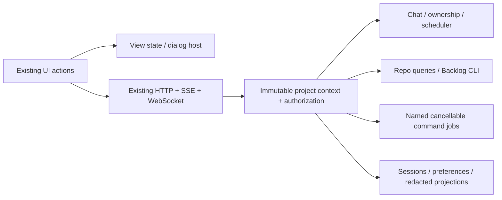

# Make the current AgentCrew UI functional

Audit: 2026-10-19. Status: implementation proposal and Antigravity handoff.
Scope: existing seven views, shell, generated controls, and detached terminal.
Preserve the current visual system; finish behavior before adding more surfaces.

## Collaboration evidence

The Antigravity inventory is the proposal being challenged here. No direct
Antigravity communication channel is available in this session; agreement is pending.
Requested independent debate command was attempted with `codex exec -m sol-6
-c model_reasoning_effort='"medium"' -s read-only`. The CLI rejected the model:
`The 'sol-6' model is not supported when using Codex with a ChatGPT account.`
No substitute model or successful CLI debate is claimed.

This document proposes contracts; it does not amend accepted ADRs. Record durable
architecture changes using `backlog decision create`. Execution work belongs in
Backlog tasks; reconcile existing TASK-40–53 before creating overlapping tickets.

## Debate: changes required to the supplied proposal

| Proposal/assumption | Audit finding and resolution |
|---|---|
| Add endpoints in routes.js/api.js | Neither exists. HTTP dispatch is `src/server/supervisor-server.js:420`; extend it with small delegated modules. Do not build a parallel server. |
| Make each icon open a modal | A modal counts only when it completes the promised operation. Selection must affect the submitted turn; settings must survive reload; commands need output and exit status. |
| Wire Send to the existing HTTP chat call | `app.js:1814` requires a takeover token but does not acquire it; active CLI sessions reject headless chat. Resolve ownership visibly, then reuse the existing streaming transport. |
| Wire Play to iteration.run | Reject. `iteration-runner.js` creates random commit identifiers, self-approves plans, and invents QA passes. Production Play must dispatch approved, eligible backlog work through the actual scheduler. |
| Show available data on all dashboards | Existing analytics include invented figures; GET metrics inserts a synthetic observation. Remove production samples, preserve honest empty/error/unknown states, and make GET read-only. |
| Switch active project globally | Existing activation mutates chat project/path but leaves RepoDataService bound to its old root. Session caches key by agent/provider, without project. Bind all operations to immutable project context before wiring more actions. |
| Sanitise arbitrary command strings | Use named jobs with fixed executable/argument arrays. A shell is intentional code execution, remains behind explicit human ownership, and cannot be made safe with string filtering. |
| Share via email | Provide local export and explicit mail-client handoff. No email transport, public share upload, or messages to external recipients are implied. |
| Every control must work | Required browser/hardware capabilities can be unavailable. Explain the actual reason and retain a usable alternative; a fake recording pulse or simulated success is unacceptable. |

## Confirmed blockers and missing audit scope

- **P0 — invented evidence:** `app.js:95` seeds a demo transcript on agent selection;
  `app.js:1620` substitutes tasks for empty/error responses;
  `repo-data-service.js:470` invents cycle time, yield, trends and line totals;
  `supervisor-server.js:622` mutates metrics on GET. Production fixture imports
  must also go; tests may retain explicit fixtures.
- **P0 — command success without execution:** `supervisor-server.js:832` accepts
  unknown commands. Reject unknown types with a stable error. Shell failures are
  caught and returned with `status: success` around line 775; preserve exit failure.
- **P0 — broken channel query:** `supervisor-server.js:476` references `parsedUrl`
  outside its scope. Pass the parsed URL into dispatch; test channel filtering.
- **P0 — unsafe content rendering:** `app.js:81` interpolates user/provider text
  into innerHTML. PR body, task, repo and project renderers also interpolate external
  values. Build text nodes; only trusted static templates may use innerHTML.
- **P0 — project identity:** activation, delayed room replies, SSE, PTY owners,
  takeover tokens, caches, scheduler keys and transcripts must carry project IDs.
  Switching tabs/projects must never reroute an already accepted operation.
- **P1 — misleading handlers:** Files & Changes opens Reviews; Idea Radar opens
  Board; rail chat shows a different feed without coherent tab state.
- **P1 — omitted controls:** rail collapse/fullscreen, both terminal popout buttons,
  wizard submit/cancel/validation, PR suggestion chips/backdrop/Escape, chart legends,
  generated project/agent/task/PR/repository cards, backup-provider settings, takeover
  mode/touch keys, mobile navigation/theme/backdrop and security-toast dismissal.
- Several apparent controls are divs: role/model pills, profile, status counts and
  idea cards. Replace with native buttons where actionable. Static labels should
  lose pointer affordances. The profile has a class, not `#topbar-user-profile`.

Static source inspection establishes these findings. It does not establish an
exhaustive browser interaction pass or provider qualification.

## Architecture and delivery rule

An action is done only when its advertised result is observable and survives the
appropriate lifecycle. Assign each control a stable `data-action` and manifest row:
selector, intent, local/server classification, handler, contract, result assertion,
error assertion, persistence rule, capability predicate. Enumerate runtime-generated
elements and `/terminal`, not just static IDs. One handler may serve many controls.

## Endpoint and command contracts

All paths below are relative to `/api/v1`. **Existing** means implemented, not
necessarily correct. **Extend/new** means proposed work. Prefer the existing
`POST /commands` mutation envelope; do not expose arbitrary SQL or process routes.

| Status | Interface | Backing behavior |
|---|---|---|
| Existing; fix isolation | GET /projects, POST /projects, POST /projects/:id/activate | Validate canonical repo root; reject unsafe switch during active ownership/work until reconciled. Activation updates every project-bound module atomically. |
| Existing; extend | GET /workspace, /agents, /readiness, /settings | Actual roster, policy and capability reports. Settings mutations use typed commands; primary role/model edits are currently missing. |
| Existing; fix | GET /tasks, /pull-requests, /repositories, /analytics, /metrics, /popups | No synthetic fallback. Explicit source, observation time and unavailable metrics. Time-range filtering must affect measured data. |
| Existing; fix | GET/POST /room/messages?channel=... | Persisted channel messages; pagination; server assigns sender identity; snapshot project before dispatching mentions. Multiple mentions become distinct scheduled deliveries. |
| Existing; reuse | POST /commands: session.takeover/release/exec, agent.ask, agent.provider_config | Ownership-checked provider chat, PR-grounded questions and optional backup configuration. Preserve streaming and terminal exclusion. |
| Existing; extend | GET /events and existing PTY WebSockets | Every event/frame includes project/session/turn ID; deduplication, reconnect and scoped subscriptions. Snapshot + cursor reconciliation; never replay a mutation on reconnect. |
| New | GET /git/status; GET /git/diff?path=...&view=working\|staged; GET /context?kind=files\|branches | Bounded real git queries, NUL-safe filenames, explicit binary/untracked/deleted/renamed states. Context selection pins path/ref/hash to a turn. |
| New | GET /health | Actual bound host/port, scheduler active/queued/held, PTY and SSE state, owned subprocesses and observed service status. No fake port-3000 green badge or arbitrary network scanner. |
| New | GET /state?collection=projects\|agents\|tasks\|sessions\|jobs | Allowlisted redacted projections, bounded pagination, schema/source metadata. No SQLite file download, raw SQL, environment dump or credential fields. |
| New | GET /command-catalog; POST /commands: command.run/cancel; GET /commands/:id | Catalog uses actual package scripts and fixed git-status command. Durable job receipt; bounded output, exit code/signal, timestamps, cancellation and terminal result. Output events use existing SSE. |
| New | GET /sessions/:id; GET /sessions/:id/events | Internal session lookup and paginated real transcript, project scoped. Deep links use internal IDs and never contain takeover secrets. |
| New | POST /commands: session.clear_view, session.reset | Clear-view records a transcript display cutoff; history remains exportable. Reset explicitly creates a new provider conversation after ownership reconciliation. Never confuse these actions. |
| New | POST /commands: agent.configure, specialist.hire; GET /specialists | Validated role/provider/model/profile revisions, backed by actual roster persistence and scheduler. Busy changes return conflict; no label-only model updates or invented provider model names. |
| New | POST /commands: scheduler.pause/resume/run_next | Pause new autonomous dispatch; run-next chooses approved eligible work, records assignment/reason and routes through actual provider/task workflow. No eligible work is an explained state. |
| New | POST /commands: message.broadcast, preferences.update | Explicit recipients and per-recipient results; max four active turns and one per agent. Persist pins/stars/tags/notifications per project/operator. |
| New | GET /knowledge; GET /knowledge/:id; typed snippet/idea save commands | Bounded repo-owned docs and persisted snippets/ideas. Ideas stay planning inputs; manual promotion writes tasks through Backlog CLI and never syncs back to GitHub. |
| New/extend | GET /attention; GET /tasks/:id; typed task.request_transition and popup.propose/decide | Real pending human gates and task details; task writes through Backlog CLI, validation and revision-bound workflow gates. Existing popup storage is in-memory; make it durable. |

Common command envelope: `{project_id, command_type, idempotency_key,
expected_version, payload}`. Bind project/root/agent configuration at admission.
Persist a UUID receipt before side effects. Async work returns 202 with command ID;
queries return actual queued/running/succeeded/failed/cancelled/unknown state.
Retrying identical requests returns the prior receipt; changed payload conflicts.
Errors include stable code, safe message and recoverability. Use 400/422 validation,
403 denied, 404 missing, 409 ownership/revision conflict, 429 overload, 503 dependency.

For initial safe project switching, reject switches while any turn/job/PTY is active
and clear project-specific browser state after activation. Scope keys and captured
contexts are still required: the switch guard alone does not repair late events.
Separate browser-local selection from daemon activation in the documented contract;
until implemented, multiple tabs share daemon activation and must reconcile it.

## Complete interaction map

L = browser behavior; S = server-backed; H = browser UI with server data/action.

| Surface / controls | Type | Required observable result |
|---|---|---|
| Home, seven view tabs, project meta buttons, Close Cockpit | L | Correct view, selected tab and focus; retain previous selection/draft. |
| Inbox, needs-input badge, Needs you/To review/Working counts | H | Correct attention/status subset with exact live counts; selecting a result opens its agent/task/gate. Inbox tooltip currently promises Kanban: align label and intent. |
| Sparkle active-turn pill | H | Inspect actual active/queued turns and their agents; zero is valid. |
| Add project, project pill/dock, onboarding wizard | H | Switcher plus real registration; inline validation; submit lock; failed registration retains input. No implied git clone or repository creation. |
| Global search and `/` | H | Search loaded agents/tasks/PRs with explicit coverage; keyboard results route to actual details. Fetch bounded server results if claiming full history. Ignore shortcuts in editable fields and terminal. |
| Team toggle, Help, Assistant, profile | L/H | Toggle roster; searchable bundled docs/real shortcut list; select configured assistant and send real provider prompt; edit local operator preferences. No invented account/PRO entitlement. |
| Expand, Code Editor, Insert Code | L | Expand/reset composer; code mode/templates insert at selection and preserve content/caret. No implication of an executable editor. |
| Tools / Context / Docs chips | H | Real catalog and selected attachments; remove/preview chips; turn includes selected tool/profile and bounded context manifest. Unavailable execution tools show why. |
| Microphone | L | Explicit start/stop, live partial text, committed transcript once, permission/error feedback. Unsupported/denied capability keeps typing usable; explain browser speech may use a remote recognition service. |
| Send / Enter / Shift+Enter | S | Real provider stream for selected agent, turn ID, pending/error/cancel states. Ignore IME composition Enter; preserve failed draft; prevent duplicate sends. |
| Session Link / Copy Output | L/H | Copy a resolvable internal session link or actual transcript; success only after clipboard completion; fallback selectable text. No mock transcript. |
| Share / More / export JSON+Markdown / Clear History | L/H | Download actual scoped history; email opens explicit mailto draft with size limits. Clear-view versus new conversation are distinct. No silent provider-history deletion. |
| Role / Model / backup selectors | S | Save actual supported configuration and revision, refresh roster, use it on next turn; fail visibly when busy/unsupported. |
| Terminal / Commands / Servers / Databases | H | Ownership-checked embedded xterm; actual named jobs/output/exit; observed health; redacted paginated state inspector. All utility tabs share one active-panel state. |
| Fast Execution / Turbo | S | Same documented execution-mode preference: reduce optional UI delay only; preserve approvals, ownership and four-slot capacity. Show effective setting; never silently enable autopilot or bypass provider safeguards. |
| Tags / Pin / Starred | L/H | Persist project-scoped tags/pins/stars and filter correctly across reload. No fake task mutations from a personal tag. |
| Split Screen (both copies) | L/H | Two independently selected agent transcript panes, responsive stacking and focus; sends target only focused pane. Single interactive PTY owner remains enforced. |
| Pop Out (both copies), detached /terminal | H | Open synchronously from gesture, handle blocked window, transfer/reconcile attachment with acknowledged handoff, reattach after close. Preserve ownership; no secret in URL/log/referrer. |
| Idea Radar / Backlog / Play | H/S | Saved ideas with explicit task promotion; real task board; eligible approved assignment dispatch/pause/resume. No canned iteration delivery. |
| Agent search / history / AI lookup / Activity vs Groups | L/H | Text filter, recent actual sessions, explicitly submitted provider-assisted roster lookup, event activity versus role grouping. AI output cannot invent roster identities. |
| Broadcast / Add specialist | S | Preview actual recipients and results; hire real persisted identity with qualified provider assignment and scheduler integration. Empty recipients and unavailable providers are explicit. |
| Tools/Knowledge dock tabs and six icons | H | Select correct dock; Terminal reuses terminal action; Signals = actual runtime events; Mail = local handoff inbox; Alerts = actionable errors/gates; Knowledge = repo docs; Snippets = persisted copy/insert workflow. Counts come from their datasets. |
| Files & Changes | H | Working/staged status and selected real diff; refresh after job/turn/git changes and on reopen. Empty, stale and inaccessible repo states are distinct. |
| Rail chat / audio / collapse / fullscreen | L/H | Actual persisted team channel; opt-in speech synthesis of real replies with mute/stop; collapse/restore; browser fullscreen plus denial feedback. Audio does not imply live provider audio. |
| Overview range, legend/contributors, KPI drilldowns | H | Actual bounded date-range data/filtering and evidence links; unavailable metrics show unknown; no moving sample charts. |
| Board cards / new popup / popup decisions | S/H | Real task details, validated Backlog transitions and durable scope proposal/approval. No fabricated estimates or operator approvals. |
| Reviews filters/cards/close/backdrop/chips/Ask | H/S | Real selected PR and matching diff, true review state, provider answer; Escape/focus restoration; GitHub errors distinct from an empty queue. |
| Repos search/cards/worktree links | H | Real matching repos/worktrees, inspect branch/status and navigate valid local detail or validated remote URL. Do not manufacture PRs from git commits. |
| Metrics / Settings controls | H/S | Evidence-derived metrics, saved effective settings/theme/accent/operator preferences, actual provider capabilities. Readiness is not qualification. |
| Footer Mobile / Machines / Chrome | L/H | Responsive-use help, actual daemon/machine connection details, detected browser capabilities. No claim of device pairing, remote fleet or Chrome installation. |
| Footer system/security/coffee/settings/split/theme/bug | L/H/S | Effective configuration/security inspector; Coffee pauses new autonomous dispatch and offers Resume; settings/split/theme reuse shared actions; diagnostics download is redacted and requires no automatic external report. |
| Mobile shell/map/terminal keys/takeover/release/warning | L/H/S | Existing navigation and keyboard behavior remains operable; correct focus, touch size and selected states; ownership transitions confirmed by server; warning dismissal scoped to tab session. |

## Rendering and failure behavior

Keep vanilla JavaScript and existing CSS tokens. Add one shared overlay module using
native `<dialog>` for modal/sheet behavior and a small menu/popover primitive.
Use existing card, form, button and theme styles; responsive drawers become sheets.
No framework migration or cosmetic redesign is needed.

Overlay lifecycle: named heading, close button, initial focus, Escape/backdrop policy,
focus restoration, inert background, independent scroll and request cancellation on
close/project change. One modal at a time; nested pickers return to their parent.
Menus support arrows/Home/End/Escape and return focus. Search is an accessible
combobox/listbox. Toasts announce results without stealing focus; actionable errors
also stay inline. Reuse the action registry for command palette and help shortcuts.

Every query has loading/empty/error/stale/ready states. Closing a drawer cancels its
query, not its accepted server job. Jobs have explicit cancellation. Failed mutations
retain input; controls cannot claim success until the server confirms the effect.
Use turn/message IDs to deduplicate HTTP results and SSE/WebSocket responses.

Security requirements tied to these controls:

- Escape all repo/provider/operator content; validate external links and treat file
  contents as untrusted context. Never interpret a transcript as executable UI.
- Keep loopback default. Same-origin checks are not authentication. Require local
  session bootstrap/authentication, Host validation and mutation-CSRF protection;
  authenticate SSE/WebSockets too. Remote mutation access requires authenticated TLS
  access; do not expand the current unauthenticated test mode into remote command access.
- Do not place takeover tokens in popout URLs. Exchange a short-lived single-use
  attachment capability via a same-origin handshake; validate origin/source and revoke
  on release. Redact auth material from inspector, diagnostics, exports and logs.
- Resolve context paths inside the selected canonical repo/worktree; reject traversal,
  symlink escape, arbitrary cwd, invalid refs/options and sensitive credential files.
  Fixed git arguments, `--` path separation, output/time/size limits, binary handling.
- Named script jobs still execute repository code: bind them to the selected trusted
  repo, display the exact command, inherit only required environment, bound processes
  and output, record failures and confirm process-tree termination on cancellation.
  Missing lint/build scripts are explicitly unavailable; never substitute a fake job.
- Read-only inspector exposes allowlisted fields, never arbitrary SQL or credentials.
  Share/diagnostics exports preview scope and redact secrets; clipboard/Blob/fullscreen/
  speech APIs have explicit unavailable/denied paths and text/manual alternatives.

## Joint implementation order

Ownership below is proposed for Antigravity's acceptance. One owner per shared file;
the existing uncommitted UI changes must be preserved. Each slice updates this matrix,
its Backlog task, behavior docs and evidence before moving on.

| Order | Codex ownership | Antigravity ownership | Exit evidence |
|---|---|---|---|
| 0. Freeze control contract | Confirm backend baseline and unknown-command/error bugs; reconcile Backlog tickets | Generate DOM/runtime inventory across seven views, shell, mobile and /terminal | Every control has action/result/test row; preserve dirty worktree. |
| 1. Make first prompt reliable | Project-scoped contexts/caches/tokens; fix channel query; remove fake iteration/metrics/success; safe rendering contract; ownership-aware streaming | Remove seeded feed/sample fallback, restore real empty states, wire selected-agent send/stream/error/cancel | Fresh launch → select configured provider → real answer → reload history; no demo output. |
| 2. Complete shell and overlays | Capability/settings/session read models and durable preferences | Shared dialog/menu/action state; topbar/search/help/profile, composer and all local controls | Keyboard/touch navigation and persisted state; context/tool selections reach next turn. |
| 3. Complete work inspection | Confined git/context queries; named jobs/receipts/cancel; health/state projections | Files drawer, four utility panels, copy/export/share, terminal/popout/split | Actual diff, command stdout+exit, cancel, truthful health, redacted state and successful reattachment. |
| 4. Complete roster and collaboration | Real specialist/profile persistence, channel/broadcast/handoff/idea/snippet writes; scheduler eligibility/pause/run-next | All roster icons, knowledge dock, ideas, audio and rail controls | Hire → select → real scheduled turn; broadcast honors slots; pause holds autonomous dispatch. |
| 5. Finish all seven views and footer | Backlog writes and gate predicates; accurate PR states, metrics and config; durable popups | Board/review/repo/metrics/settings action details, every footer/mobile control | Real task lifecycle/gates, date-range evidence and restart persistence; zero synthetic success. |
| 6. Release verification | Contract/security/process/restart/isolation checks; CI-equivalent commands; docs corrections | Browser action coverage at desktop+mobile, keyboard, unavailable capabilities and recovery | All controls pass declared outcomes; both implementation owners review evidence. |

First usable milestone is slice 1, followed immediately by remaining slices. It is
not the completion claim for this request. No new mock features, desktop packaging,
provider integrations, design overhaul or general-purpose terminal fleet are prerequisites.

## Acceptance and release gates

1. Browser traversal covers every manifest control, generated card, form, hidden
   state, keyboard shortcut and detached route. Assert actual DOM/state/server effect;
   checking that a listener exists or a modal opens is insufficient.
2. Run real happy paths in a disposable git repo: chat, context attachment, model
   configuration, persisted history, git diff, job exit/failure/cancel, task/popup
   transitions, specialist turn, broadcast, terminal handoff and project activation.
3. Exercise missing CLI/auth/quota, unavailable microphone, denied clipboard,
   blocked popout/fullscreen, missing package scripts, unavailable GitHub, binary diff,
   empty data, server restart, disconnect/reconnect, stale revision and double submit.
4. Cross-project tests use identical agent names and concurrent delayed responses.
   Project A output/session/task/PTY must never appear in B. Test two tabs and
   activation rejection while busy. Pause/cancel/release require confirmed quiescence.
5. Test content injection, path/ref/option injection, symlink escape, unknown commands,
   unauthenticated/cross-origin requests and sensitive-data redaction. GETs create
   no tasks, evidence or metrics. Failures cannot return successful receipts/results.
6. Test keyboard focus/Escape/IME, mobile touch/terminal keys and layouts at desktop
   and phone widths. Include theme/reduced-motion states. Browser capability tests
   may use controlled fakes; real recognition/device support stays explicitly limited.
7. Run `npm ci` and `npm test` under Node 24, plus the workflow's Windows contract
   command on Windows CI. Linux cannot certify Windows behavior. Add behavioral
   browser tests to CI; current UI bundle tests mostly assert source strings.
   Fake providers only in CI; local authenticated provider smoke is separate evidence.
8. Update PRD/TRD/README and current-memory claims alongside behavioral changes.
   Run repository workflows before opening any PR; use PRs, never push directly to main.

Release criterion: no enabled control lacks its advertised effect; no displayed
success is invented. Environmental unavailability is visible and recoverable, never
counted as a successful execution. This audit/plan does not certify that criterion.
